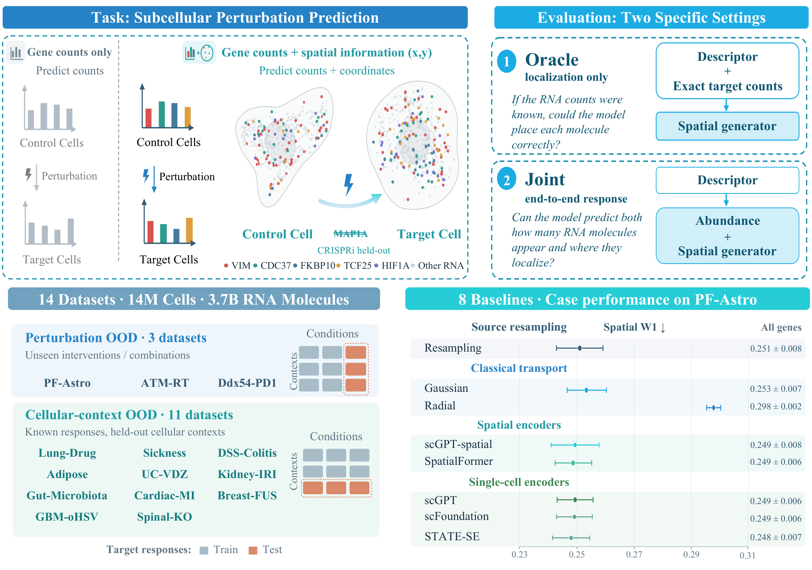

<h1 align="center">SubcellPert: Benchmarking Subcellular Perturbation Prediction</h1>

<p align="center">
  <a href="https://personal-page.wjh.app/">Jinghao Wang</a><sup>1</sup>,
  <a href="https://chq1155.github.io/">Hanqun Cao</a><sup>1</sup>,
  <a href="https://icecreamartist.github.io/">Xilin Dang</a><sup>1</sup>,
  <a href="https://scholar.google.com/citations?user=aUerEOMAAAAJ">Tianhui Zhou</a><sup>2</sup>,<br>
  <a href="https://yiyangzha0.github.io/">Yiyang Zhao</a><sup>3,4</sup>,
  <a href="https://scholar.google.com/citations?user=K-AjhSgAAAAJ">Chang-Yu Hsieh</a><sup>3</sup>,
  <a href="https://scholar.google.com/citations?user=BlSFT8UAAAAJ">Chunbin Gu</a><sup>1,✉</sup>,
  <a href="https://appsrv.cse.cuhk.edu.hk/~pheng/index.php">Pheng Ann Heng</a><sup>1</sup>
</p>

<p align="center">
  <sup>1</sup> The Chinese University of Hong Kong &nbsp;
  <sup>2</sup> Duke University<br>
  <sup>3</sup> Zhejiang University &nbsp;
  <sup>4</sup> Shanghai Innovation Institute<br>
</p>

<div align="center">
  
  
  <a href="https://personal-page.wjh.app/SubcellPert/" target="_blank" rel="noopener noreferrer"></a>
  <a href="https://huggingface.co/datasets/king159/SubcellPert" target="_blank" rel="noopener noreferrer"></a>
</div>

> **TL;DR:** SubcellPert benchmarks perturbation-response prediction across 14 imaging datasets and eight baselines, extending virtual cell evaluation from gene counts to intracellular RNA organization.

<p align="center">
  
</p>

## 📄 Abstract

Perturbations change RNA abundance and intracellular organization, but gene-count
predictors omit the positions needed to model spatial responses. SubcellPert
introduces perturbation-response prediction at single-RNA-molecule resolution,
with **14 imaging datasets, 13.88 million cells, and 3.65 billion RNA molecules**.
Given source observations and a directed condition change, models generate target
RNA populations in normalized two-dimensional coordinates.

Two independently trained tasks separate abundance from localization: **Oracle**
predicts coordinates given exact target counts; **Joint** predicts both. Eight
baselines span source resampling, classical transport, and frozen foundation-model
adapters. Perturbation and cellular-context holdouts evaluate abundance error,
target-gene coverage, and conditional spatial error. This repository provides the
data loading, baseline adapters, training, validation, and evaluation code.

## 🗂️ Codebase Structure

<details>
<summary>Repository layout</summary>

```text
SubcellPert/
├── benchmark/           # Frozen schedules and sampling protocol
├── configs/
│   ├── datasets/        # Dataset definitions
│   ├── models/          # Foundation-model settings and weight checksums
│   ├── oracle/          # Localization with target counts
│   └── joint/           # Abundance and localization prediction
├── docs/                # README figures
├── src/subcellpert/     # Data loading, baselines, training, and evaluation
├── LICENSE
└── pyproject.toml
```

</details>

### 🛠️ Environment Setup

Use **Linux and Python 3.12**. Dependencies, including the pinned PyTorch and
torchvision versions, are specified in [pyproject.toml](pyproject.toml).
GPU runs require a compatible NVIDIA driver. Install
[uv](https://docs.astral.sh/uv/getting-started/installation/) first.
On a shared cluster, install dependencies on a networked login node into shared
storage, then use an allocated compute node for environment checks and experiments.

Run these commands from the code repository root:

```bash
uv venv --python 3.12 .venv
source .venv/bin/activate
uv pip install -e .
python -m subcellpert.main --help
```

Data and pretrained weights are downloaded separately. Keep each model's
weights, vocabulary, and configuration together under `weights/<model>/`,
using the paths specified in [configs/models/](configs/models/).

### 💾 Data Preparation

The dataset repository is [HF king159/SubcellPert](https://huggingface.co/datasets/king159/SubcellPert).

Authenticate with `hf auth login` or `HF_TOKEN`. Use a new, empty destination:
the Hub downloader does not remove leftover files from older snapshots. On
clusters without compute-node internet access, download on a networked login
node to shared storage, then validate and run experiments in a compute allocation.

<details open>
<summary>Download the pinned dataset snapshot</summary>

```bash
export SUBCELLPERT_CODE="$PWD"
export SUBCELLPERT_ROOT="$PWD/data/subcellpert_population_min50_20260924"
export SUBCELLPERT_DATA_REVISION="b6db87c2023de68344e2c4a4a8d45a03eb86fdb7"

python - <<'PY'
import os
from huggingface_hub import snapshot_download

snapshot_download(
    repo_id="king159/SubcellPert",
    repo_type="dataset",
    revision=os.environ["SUBCELLPERT_DATA_REVISION"],
    local_dir=os.environ["SUBCELLPERT_ROOT"],
    ignore_patterns=[".gitattributes"],
    token=True,
)
PY
```

</details>

`.gitattributes` is Hub repository metadata and is excluded from the download.
Follow the
[dataset validation instructions](src/subcellpert/data/RELEASE.md#validate-a-downloaded-snapshot)
to check the inventory and content hashes. Keep the bundle together so its
relative paths remain valid.

See the [dataset format](src/subcellpert/data/RELEASE.md) for the bundle layout.

## 🧬 SubcellPert

### 📐 Evaluation Protocol

The benchmark has two independently fitted settings:

| Setting | Prediction task | Evaluation |
| --- | --- | --- |
| **Oracle** | Predict RNA coordinates given target per-cell gene counts | Spatial W1 |
| **Joint** | Predict gene counts and RNA coordinates from source cells and a condition change | Expression MSE, PCC-delta, gene coverage, and conditional spatial W1 |

There are **224 run configurations**: 14 datasets × eight baselines × two settings.
The frozen schedule contains 38 dataset/split instances and 608 planned fits.
Most datasets have split seeds 1–3; ATM-RT and DDX54-PD1 have seed 1 only.
These are data-split seeds, not an additional model-seed sweep.

### 🧪 Baselines

| Baseline | Configuration name | Pretrained weights |
| --- | --- | --- |
| Count-matched resampling | `count_matched_resampling` | Not required |
| Gaussian affine transport | `gaussian_affine_transport` | Not required |
| Radial quantile transport | `radial_quantile_transport` | Not required |
| scGPT | `scgpt` | Required |
| scGPT-spatial | `scgpt_spatial` | Required |
| scFoundation | `scfoundation` | Required |
| SpatialFormer | `spatialformer` | Required |
| STATE-SE | `state_se` | Required |

The five foundation-model baselines use frozen encoders with trainable
prediction heads. Their networks are implemented directly in
`src/subcellpert/models/`; no upstream source checkout is required. Resource
locations are specified in [configs/models/](configs/models/), with checksums
in [checkpoints.sha256](configs/models/checkpoints.sha256).
When code and data live in separate directories, expose the complete weight
directory at the data root before running these baselines:

```bash
ln -s "$SUBCELLPERT_CODE/weights" "$SUBCELLPERT_ROOT/weights"
```

Create this link only if the destination does not already exist.

### 🚀 Training

Run from the code repository root with `SUBCELLPERT_ROOT` pointing to the
prepared data snapshot. Each command fits a baseline, performs validation
where the frozen split provides it, and evaluates held-out responses.

#### 🔎 Start with a smoke run

This small Oracle example uses a classical baseline and needs no pretrained weights:

```bash
python -m subcellpert.main \
  --project-root "$SUBCELLPERT_ROOT" \
  --config configs/oracle/pf-astro/count_matched_resampling.yaml \
  --seed 1 --fit-group seed1 --device cpu --smoke \
  --output "$SUBCELLPERT_CODE/outputs/smoke/oracle/pf-astro/resampling/seed1"
```

`--smoke` bounds the workload for a diagnostic run; its outputs are not benchmark
results. Use `--dry-run` to inspect the resolved configuration and selected jobs
without training.

#### 🏋️ Run a full fit

After the smoke run, remove `--smoke` and choose a fresh output directory:

```bash
python -m subcellpert.main \
  --project-root "$SUBCELLPERT_ROOT" \
  --config configs/oracle/pf-astro/count_matched_resampling.yaml \
  --seed 1 --fit-group seed1 --device cuda \
  --output "$SUBCELLPERT_CODE/outputs/reproduction/oracle/pf-astro/resampling/seed1"
```

Classical baselines support `--device cpu` as well. To run Joint, select the
corresponding YAML under `configs/joint/` and use a separate output directory.
All available dataset, baseline, setting, and split-seed choices are listed in
[configs/README.md](configs/README.md).

For example, after preparing its pretrained resources, train the Joint scGPT adapter:

```bash
python -m subcellpert.main \
  --project-root "$SUBCELLPERT_ROOT" \
  --config configs/joint/pf-astro/scgpt.yaml \
  --seed 1 --fit-group seed1 --device cuda \
  --output "$SUBCELLPERT_CODE/outputs/reproduction/joint/pf-astro/scgpt/seed1"
```

The five foundation-model configurations specify five epochs, BF16, and a global
training batch of 256. Encoder microbatches may be smaller without changing the
optimizer batch. Scientific settings are defined in the YAML files.

> Use a fresh output directory for every new fit. The CLI replaces generated
> files unless `--resume` is supplied. Resume a stopped fit with its original
> command plus `--resume`, keeping the code, data, weights, and training settings
> unchanged.

### 📊 Validation and Results

Foundation-model fits select checkpoints using the validation split. ATM-RT
and DDX54-PD1 have no validation split and use the final epoch. Test responses
are reserved for evaluation. Joint and Oracle are fitted independently.

Each fit saves its resolved configuration in `run_config.json`, its checkpoint
in `cell_model.pt`, and evaluation results in `result.json`. Per-response
predictions and metrics are stored under `responses/`. A completed benchmark
fit has `status: "complete"` and `scientific_result: true` in `result.json`.

Report **Joint expression MSE and PCC-delta** and **Oracle spatial W1** separately.
The all-gene panel is primary; the top-100 DEG panel is supplementary. Shared-gene
spatial scores and target-gene coverage are diagnostics: a missing predicted
gene does not have zero spatial error. Compare spatial scores only over matching
gene support.

### 📄 License

Original SubcellPert code is released under the [MIT license](LICENSE).
Integrated foundation-model code retains its original terms; attribution and
license texts are included in the same [LICENSE](LICENSE) file.
Pretrained weights and source datasets retain their respective terms.
